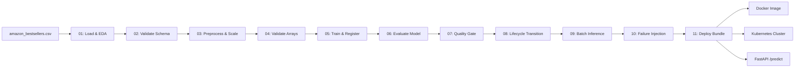

# Amazon Bestseller MLOps Project — System Architecture

---

## Overview

This document describes the technical architecture of the Amazon Bestselling Books Genre Classification MLOps system implemented in `amazooonnnn/`.

---

## Domain Problem

Binary classification of Amazon Top-50 Bestselling Books (2009–2019) into:
- `0` = Fiction
- `1` = Non Fiction

**Input features**: `User Rating` (0–5), `Reviews_Log` (log1p transformed), `Price` (USD), `Year` (2009–2019)

---

## Project Structure
```
amazooonnnn/
├── config.yaml                       # Centralized YAML configuration
├── Dockerfile                        # Production container image
├── requirements.txt                  # Full dependency list
├── requirements-api.txt              # API-only minimal dependencies
├── api/                              # FastAPI REST service
│   ├── __init__.py
│   ├── main.py                       # Endpoints: /, /health, /metadata, /predict, /predict/batch
│   ├── model_loader.py               # Singleton model and scaler loading
│   └── preprocessing.py              # Raw feature extraction and scaling
├── data/
│   ├── raw/
│   │   └── amazon_bestsellers.csv    # 550 rows, 7 columns
│   └── processed/
│       ├── X_train_final.npy         # (440, 4) scaled training features
│       ├── X_test_final.npy          # (110, 4) scaled test features
│       ├── y_train.npy               # (440,) binary training labels
│       └── y_test.npy                # (110,) binary test labels
├── deployment/
│   ├── production_model.pkl          # Serialized champion model
│   ├── scaler.pkl                    # Fitted StandardScaler
│   └── model_metadata.json           # Model lineage metadata
├── docs/                             # 11 Lab Reports
├── k8s/
│   ├── deployment.yaml               # Kubernetes 2-replica Deployment
│   └── service.yaml                  # Kubernetes NodePort Service
├── models/
│   ├── production_model.pkl
│   ├── random_forest_model.pkl
│   └── scaler.pkl
├── pipelines/                        # Legacy pipeline runners
├── reports/
│   ├── evaluation_report.json
│   ├── quality_gate_report.json
│   ├── lifecycle_report.json
│   └── failure_report.json
├── src/
│   ├── config.py                     # Centralized path and config imports
│   ├── preprocess.py                 # Preprocessing module
│   ├── train.py                      # Baseline training
│   ├── evaluate.py                   # Metric computation
│   ├── train_mlflow.py               # Full experiment tracking
│   ├── train_registry.py             # Registry training
│   ├── predict.py                    # Production predictor
│   └── mlops_pipeline/               # 11-stage modular pipeline
│       ├── 01_load_data.py
│       ├── 02_validate_data.py
│       ├── 03_preprocessing.py
│       ├── 04_validate_outputs.py
│       ├── 05_train_registry.py
│       ├── 06_model_evaluation.py
│       ├── 07_quality_gate.py
│       ├── 08_automate_lifecycle.py
│       ├── 09_inference.py
│       ├── 10_failure_injection.py
│       ├── 11_prepare_deployment.py
│       └── amazon_genre_pipeline.py  # Master 11-stage orchestrator
└── tests/
    ├── direct_client.py              # In-process Windows-safe test client
    ├── test_api.py                   # 23 API tests
    ├── test_performance.py           # 6 performance benchmarks
    └── test_pipeline.py              # 6 pipeline and reproducibility tests
```

---

## MLflow Backend Architecture

| Component | Technology | Location |
| :--- | :--- | :--- |
| Tracking URI | SQLite | `amazooonnnn/mlflow.db` |
| Artifact Store | Local filesystem | `amazooonnnn/mlruns/` |
| Experiment | Amazon_Bestseller_Genre_Prediction | Via `mlflow.set_experiment()` |
| Model Registry | SQLite + local artifact store | `amazooonnnn/mlflow.db` |

---

## Classification Pipeline Diagram



---

## Model Performance Summary

| Metric | Value |
| :--- | :--- |
| Accuracy | 0.7909 |
| Precision (Weighted) | 0.7915 |
| Recall (Weighted) | 0.7909 |
| F1-Score (Weighted) | 0.7859 |
| ROC-AUC | 0.8740 |
| Quality Gate | PASSED (F1 ≥ 0.70) |
