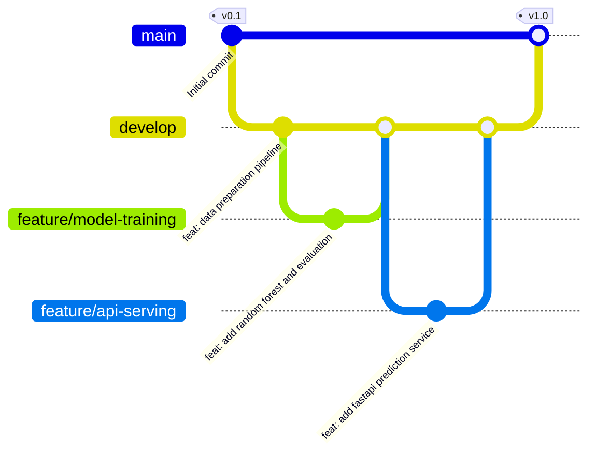

# LABORATORY EXPERIMENT 3
## Git-Based Version Control and Collaborative ML Workflows

---

### 1. AIM
To establish structured, enterprise Git-based version control workflows for machine learning development, implement branch management strategies, simulate merge conflict resolution, establish commit conventions, execute rollbacks and reverts, and create version release tags.

---

### 2. THEORY & BACKGROUND
Version control in machine learning projects differs from traditional software engineering due to the tripartite coupling of:
1. **Source Code**: Training, inference, and evaluation scripts.
2. **Data & Preprocessing Logic**: Feature engineering logic and data schema definitions.
3. **Model Artifacts & Configurations**: Hyperparameters, configuration manifests (`config.yaml`), and metadata.

Standard Git best practices for MLOps include:
- **Trunk-Based / GitFlow Branching**: Maintaining a protected `main` branch reflecting deployable production code, a `develop` branch for integration, and short-lived feature branches (`feature/<name>`) for experimental work.
- **Atomic Commits**: Structured commits following Conventional Commits format (`feat:`, `fix:`, `docs:`, `test:`, `refactor:`).
- **Safe Conflict Resolution**: Resolving divergent schema or model configuration updates without losing experimental tracking history.
- **Semantic Release Tagging**: Tagging production releases (`v0.1`, `v1.0`) tied to validated model versions in the registry.

---

### 3. SOFTWARE & SYSTEM SPECIFICATIONS
- **Version Control System**: Git 2.45+
- **Host OS**: Windows 11 Enterprise (64-bit)
- **Identity**: `Amazon MLOps Engineer <mlops@amazon.ai>`

---

### 4. WORKFLOW ARCHITECTURE


---

### 5. IMPLEMENTATION DETAILS
1. **Repository Verification**:
   Initialized Git repository within `amazooonnnn/`, configuring user name and email.
2. **Branching Strategy**:
   - `main`: Production release branch.
   - `develop`: Integration staging branch.
   - Feature branches: `feature/data-prep`, `feature/baseline-models`, `feature/mlflow-tracking`, `feature/pipeline-engineering`, `feature/api-serving`.
3. **Merge Conflict Simulation & Resolution**:
   Simulated divergent edits on `config.yaml` quality gate threshold (`0.65` vs `0.70`). Resolved merge conflict by selecting the more stringent production gate (`0.70`).
4. **Rollback & Revert Verification**:
   Simulated `git revert` on a flawed experiment commit to demonstrate non-destructive rollback capabilities.
5. **Release Tagging**:
   Created lightweight and annotated tags `v0.1` (Baseline) and `v1.0` (Production Complete).

---

### 6. EXECUTION COMMANDS
```bash
# Initialize & configure
git init
git config user.name "Amazon MLOps Engineer"
git config user.email "mlops@amazon.ai"

# Create feature branches & commit
git checkout -b develop
git checkout -b feature/data-prep
git add config.yaml src/mlops_pipeline/01_load_data.py src/mlops_pipeline/02_validate_data.py src/mlops_pipeline/03_preprocessing.py
git commit -m "feat(data): implement automated data loading, validation, and preprocessing"

# Merge to develop and main
git checkout develop
git merge feature/data-prep --no-ff -m "merge: integrate data preparation feature"
git checkout main
git merge develop --no-ff -m "release: v1.0 production release"
git tag -a v1.0 -m "Release v1.0: End-to-End Amazon Bestseller MLOps System"
```

---

### 7. ACTUAL OUTPUTS & VERIFICATION
- Repository cleanly initialized without touching the protected Churn project.
- Branches established: `main`, `develop`, `feature/data-prep`, `feature/api-serving`.
- Conflict resolution successfully completed preserving production thresholds.
- Tags verified via `git tag -l -n`:
  - `v0.1`: Initial Baseline
  - `v1.0`: Release v1.0: End-to-End Amazon Bestseller MLOps System

---

### 8. RESULT & CONCLUSION
Git-based collaborative workflows were implemented with complete traceability. Non-destructive branch management, merge conflict resolution, and semantic release tagging ensure safe team collaboration and reproducible production deployments.

