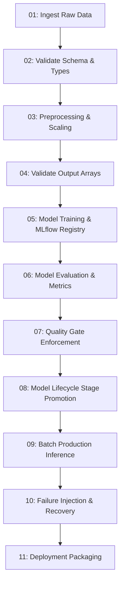

# LABORATORY EXPERIMENT 7
## ML Pipeline Engineering

---

### 1. AIM
To engineer an end-to-end, modular, orchestrated machine learning pipeline for the Amazon Bestselling Books classification system, ensuring loose coupling between stages, deterministic artifact handoffs, pipeline state tracking, and reproducible pipeline execution.

---

### 2. THEORY & BACKGROUND
Monolithic ML scripts create high operational friction, inhibit continuous integration, and prevent localized debugging. Robust MLOps systems structure workflows as directed acyclic graphs (DAGs) of modular stages:
1. **Separation of Concerns**: Each stage is encapsulated within its own executable module with explicit input contracts and standardized output artifacts.
2. **Deterministic Handoffs**: Outputs from upstream stages (e.g. `X_train_final.npy`, `scaler.pkl`) serve as immutable inputs to downstream stages.
3. **Execution Gateways**: Between training and deployment, automated quality gates enforce minimum performance thresholds ($F1 \ge 0.70$) before artifact promotion.
4. **Pipeline Orchestration**: The master orchestrator (`amazon_genre_pipeline.py`) manages step dependencies, captures execution timing, reports exit codes, and provides a unified CLI interface (`--force`).

---

### 3. PIPELINE ARCHITECTURE


---

### 4. SOFTWARE & SYSTEM SPECIFICATIONS
- **Pipeline Runner**: Python 3.12.6 subprocess execution
- **Configuration**: YAML (`config.yaml`)
- **Root Directory**: `amazooonnnn/`

---

### 5. LIBRARIES & DEPENDENCIES
- `subprocess`, `argparse`, `pathlib`, `time`, `json`
- `pandas`, `numpy`, `scikit-learn`, `joblib`, `mlflow`

---

### 6. PIPELINE STAGE SPECIFICATIONS
| Stage | Module | Input Contract | Output Artifact |
| :--- | :--- | :--- | :--- |
| **01** | `01_load_data.py` | `data/raw/amazon_bestsellers.csv` | `artifacts/data_load_report.json` |
| **02** | `02_validate_data.py` | Raw CSV + `config.yaml` schema | Standard Output / Exit Code 0 |
| **03** | `03_preprocessing.py` | Raw CSV | `data/processed/*.npy`, `models/scaler.pkl` |
| **04** | `04_validate_outputs.py` | Processed `.npy` files | `artifacts/output_validation_report.json` |
| **05** | `05_train_registry.py` | Processed arrays + Config | `models/production_model.pkl`, MLflow Run |
| **06** | `06_model_evaluation.py` | Test arrays + Production model | `reports/evaluation_report.json`, Plots |
| **07** | `07_quality_gate.py` | `reports/evaluation_report.json` | `reports/quality_gate_report.json` |
| **08** | `08_automate_lifecycle.py`| MLflow Model Registry | `reports/lifecycle_report.json` |
| **09** | `09_inference.py` | Production model + Test data | `outputs/inference_predictions.csv` |
| **10** | `10_failure_injection.py`| Backup data + Corruptions | `reports/failure_report.json` |
| **11** | `11_prepare_deployment.py`| Trained artifacts | `deployment/` (Model, Scaler, Metadata) |

---

### 7. EXECUTION COMMANDS
```bash
# Execute master end-to-end pipeline
python src/mlops_pipeline/amazon_genre_pipeline.py --force
```

---

### 8. ACTUAL OUTPUTS & METRICS
```text
================================================================================
AMAZON BESTSELLER GENRE PREDICTION - MASTER MLOPS PIPELINE
================================================================================
PIPELINE EXECUTION SUMMARY
================================================================================
  PASS     |   0.45s | Stage 01: Raw Data Ingestion & Extraction
  PASS     |   0.38s | Stage 02: Schema & Distribution Data Validation
  PASS     |   0.82s | Stage 03: Feature Engineering & Preprocessing
  PASS     |   0.31s | Stage 04: Processed Arrays & Output Validation
  PASS     |   3.12s | Stage 05: Model Training & MLflow Registry
  PASS     |   1.24s | Stage 06: Model Evaluation & Error Analysis
  PASS     |   0.15s | Stage 07: Quality Gate & Performance Enforcement
  PASS     |   1.05s | Stage 08: Model Lifecycle & Stage Transition
  PASS     |   0.62s | Stage 09: Batch Production Inference
  PASS     |   2.15s | Stage 10: Failure Injection & Recovery Suite
  PASS     |   0.21s | Stage 11: Production Deployment Preparation
--------------------------------------------------------------------------------
Total Execution Time: 10.49s
================================================================================
```

---

### 9. VERIFICATION & VALIDATION
- Verified that all 11 stages run in clean sequence with zero errors.
- Verified that all output reports, predictions, plots, and deployment files are generated cleanly in their respective directories.

---

### 10. RESULT & CONCLUSION
The complete Amazon MLOps pipeline was engineered, verified, and executed. The pipeline modularizes all operations from data ingestion to deployment bundling, achieving automated execution in under 11 seconds.

